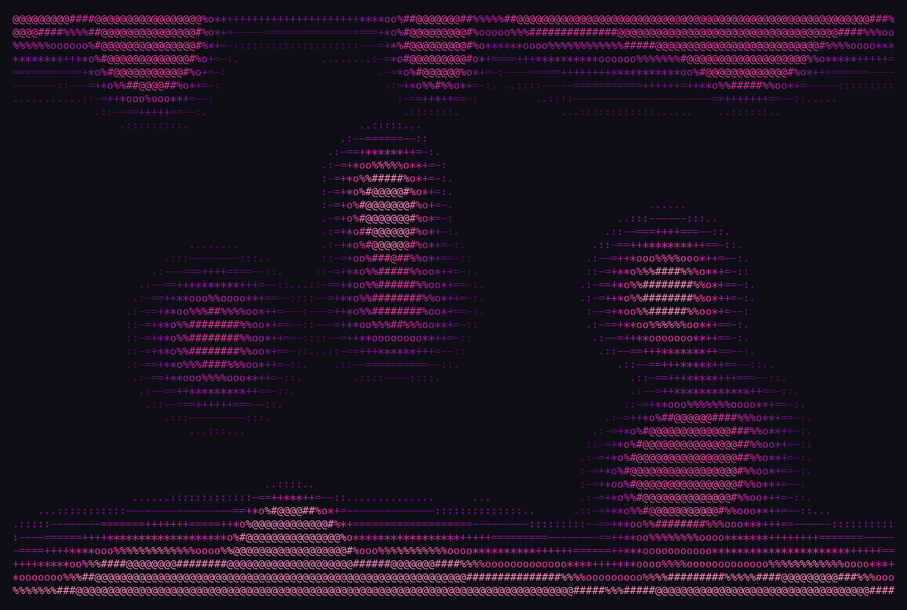
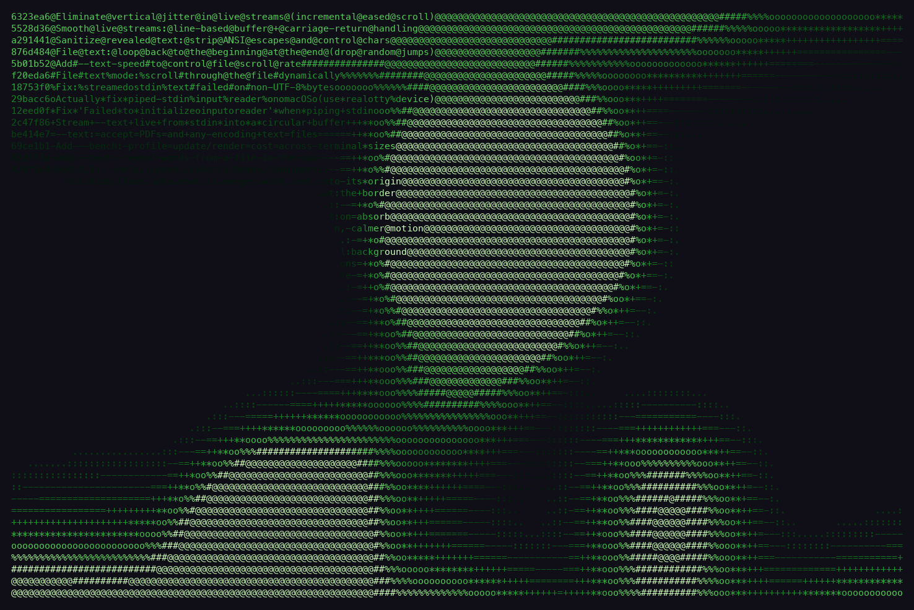
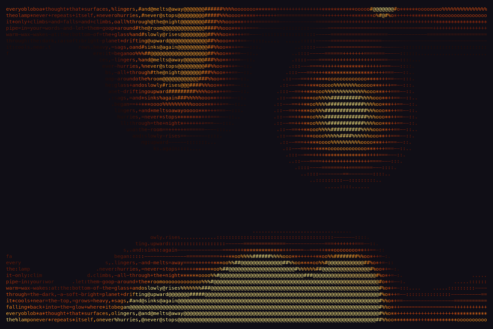
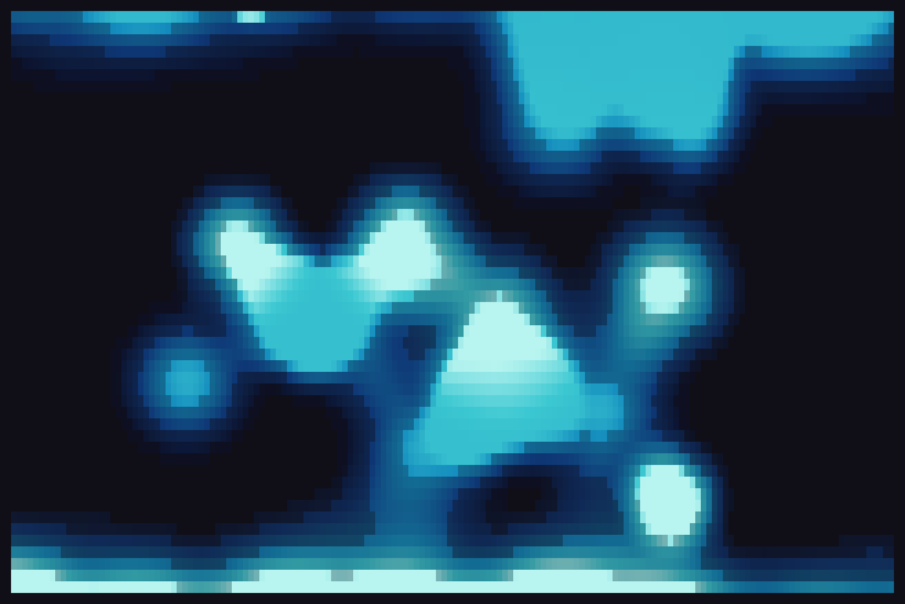

# lavascii

A full-color ASCII lava lamp for your terminal, **written in Rust**, in the
spirit of `asciiquarium` and `cmatrix`. It resizes freely with the window.

**Pipe any text into it** and the words appear inside the wax as it flows:
logs, speech-to-text, `fortune`, or any other command's output.

```sh
tail -f /var/log/system.log | lavascii
```



## Screenshots

| Piped stdin: `git log --oneline \| lavascii -c green` | Text reveal: `lavascii --text poem.txt -c ember` |
|---|---|
|  |  |

`lavascii --scheme ocean --ramp blocks`



## Install

lavascii is a single Rust binary. You need a Rust toolchain
([rustup](https://rustup.rs)) to build it. Build and install the `lavascii`
binary onto your PATH:

```sh
cargo install --path .
```

Then run it from anywhere:

```sh
lavascii
```

Or grab a standalone binary without installing:

```sh
cargo build --release   # -> target/release/lavascii
```

## Run

```sh
lavascii                                  # defaults
lavascii --scheme ocean --speed 0.6       # calm blue lamp
lavascii -c ember -d 1.5 -f 60            # busy warm lamp at 60fps
lavascii --scheme rainbow --ramp blocks   # solid-block rainbow
lavascii --mono                           # no color, just glyphs
lavascii --text poem.txt -c ember         # wax reveals your words
```

With `--text`, the file's words are laid across the screen and the flowing wax
reveals them where it covers them (colored by density); word gaps inside a blob
fall back to the glyph ramp so the wax still looks solid. The file is wrapped
into a tall canvas and the visible window **scrolls slowly downward** through it
(about one line every 1.5s at the default rate), looping seamlessly back to the
top when it reaches the end — so the lamp keeps drifting through the whole file,
staying dynamic but readable rather than frozen on the opening lines. Tune the
pace with `--text-speed <rows/sec>` (`0` holds it static). The file can be a plain-text file (any
encoding — non-UTF-8 is read lossily) or a **PDF** (text is extracted
automatically; scanned/image-only PDFs have no selectable text). Preview any
combination without a live terminal by adding `--test`, e.g.
`lavascii --test --text paper.pdf`.

### Piping text in

Any text can be piped into `lavascii` (or pass `--text -`), and it is shown
live as it arrives on stdin. Incoming lines flow into a bounded ring buffer (the most recent
~8 KB) and the view stays anchored to the newest lines, scrolling up like a log
tail, so an endless feed stays light and smooth:

```sh
echo "hello lava world" | lavascii
tail -f /var/log/system.log | lavascii -c green   # watch logs goop by
vtt-stdout | lavascii -c ember                    # live speech-to-text
fortune | lavascii --scheme sunset
```

Live inputs are cleaned before display: ANSI escape sequences and control
characters are stripped, and lines rewritten in place with carriage returns
(voice-to-text refining its guess, progress meters) collapse to their final
revision — so nothing corrupts the terminal or shows as gibberish. Keyboard
controls still work while piping (they're read from the terminal, not stdin).

Resize the window any time — the scene reflows and rescales live.

### Options

| Flag | | Description | Default |
|---|---|---|---|
| `-s` | `--speed <F>` | Simulation speed multiplier (0.1–5) | `1.0` |
| `-c` | `--scheme <NAME>` | Color scheme (see below) | `magenta` |
| `-d` | `--density <F>` | Blob-count multiplier (0.3–4) | `1.0` |
| `-z` | `--size <F>` | Blob-size multiplier (0.3–2) | `1.0` |
| `-f` | `--fps <N>` | Target frame rate (5–120) | `30` |
| `-r` | `--ramp <NAME>` | Glyph ramp: `ascii`, `blocks`, `dots`, `shade` | `ascii` |
| `-t` | `--text <FILE>` | Reveal the words from a text file or PDF in the wax | |
|  | `--text-speed <F>` | Scroll speed through a `--text` file, rows/sec (`0` = static) | `0.7` |
|  | `--mono` | Monochrome (no color, just glyphs) | |
|  | `--seed <N>` | Fixed PRNG seed (reproducible) | random |
| `-h` | `--help` | Print help | |
| `-V` | `--version` | Print version | |

**Color schemes:** `magenta` · `ember` · `green` · `ocean` · `sunset` · `ice` · `rainbow` · `mono`

### Interactive keys

| Key | Action | Key | Action |
|---|---|---|---|
| `q` / `Esc` | quit | `space` | pause / resume |
| `+` / `-` | faster / slower | `c` | cycle color scheme |
| `r` | cycle glyph ramp | `m` | toggle monochrome |

Preview the shape without a live terminal:

```sh
cargo run --release -- --test
```

## How it works

- **Metaballs.** Every wax body (free blobs + the top/bottom pools) contributes
  a smooth, finite-support field. Fields add, so bodies fuse into goopy necks as
  they approach — merges look organic for free.
- **Temperature is blended, never overwritten.** Each body carries a
  temperature; a cell's color is the field-weighted average of nearby bodies.
  Two blobs that touch *mix* their heat instead of erasing each other, so a
  blob can't get stranded neutral-buoyant in the middle.
- **The cycle.** A hot pool sits at the bottom, a cold pool hangs from the top.
  Heat exchange bites only in those end zones; the middle is near-adiabatic, so
  momentum carries a blob through without equilibrating. Hot wax rises, cools
  at the top, sinks, reheats at the bottom.
- **Sizing.** Maximum blob radius derives from `min(width, height·2)`, so a
  wide-but-short window stays limited by its height (no giant blobs), with a
  hard upper cap and free shrinking for small windows.
- **Flow, not pops.** New blobs are born hidden inside a pool and ooze out as
  they rise/fall; absorbed blobs melt into the pool; when a small blob merges
  into a bigger one it flows into it rather than vanishing at its own spot.

Full RGB truecolor output; a 24-bit-color terminal is recommended (use `--mono`
otherwise).
